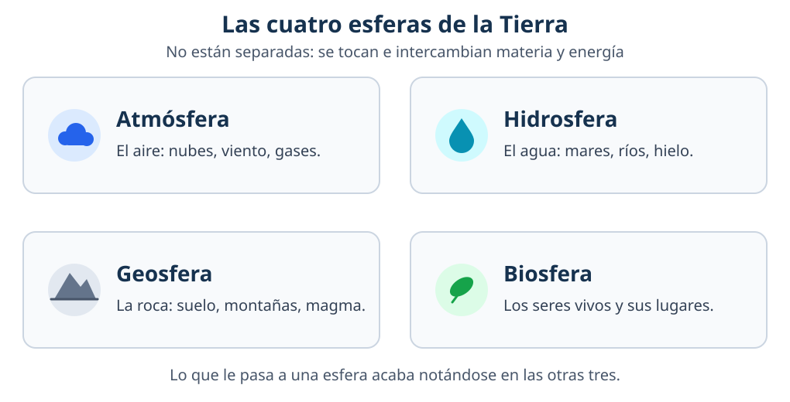
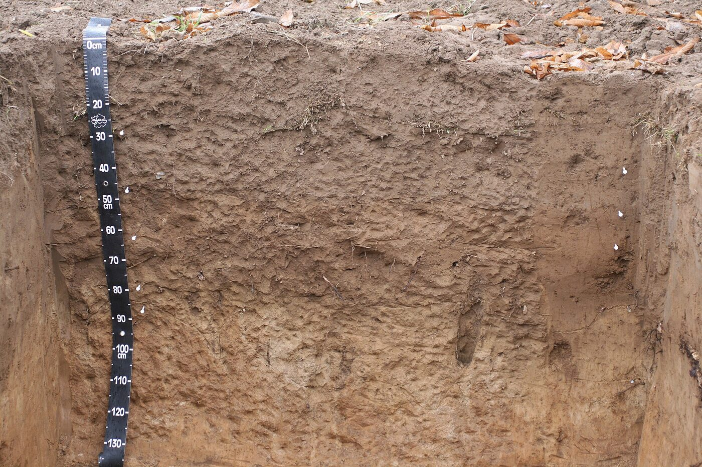
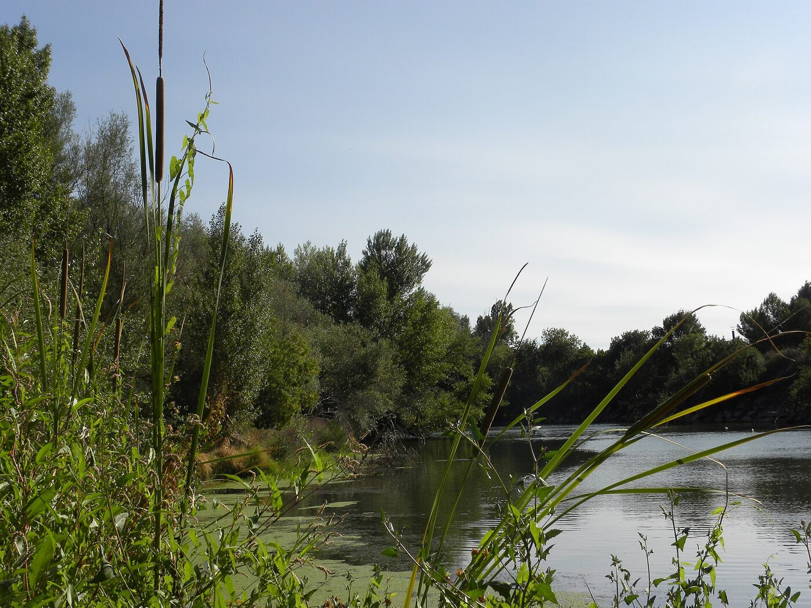
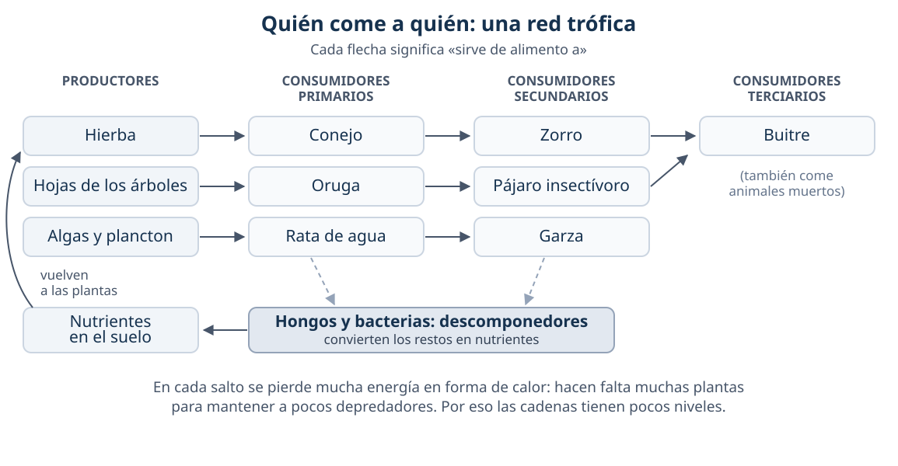
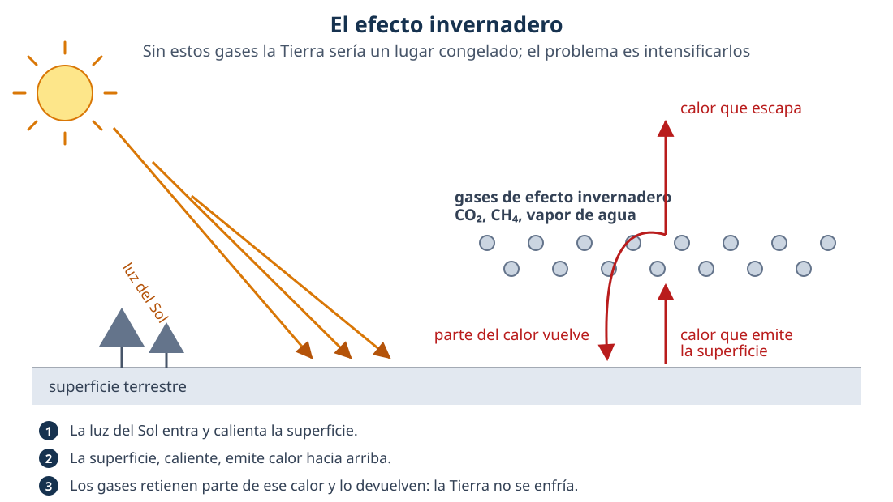
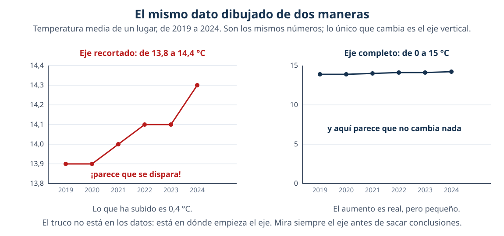
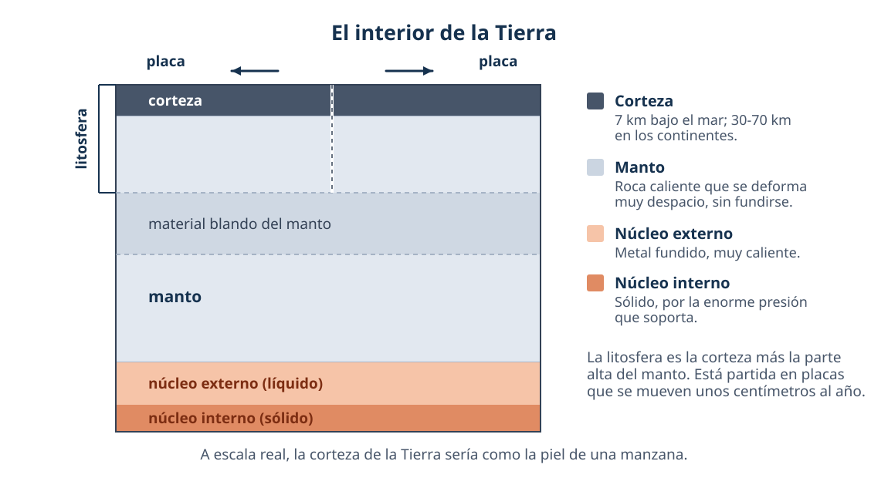
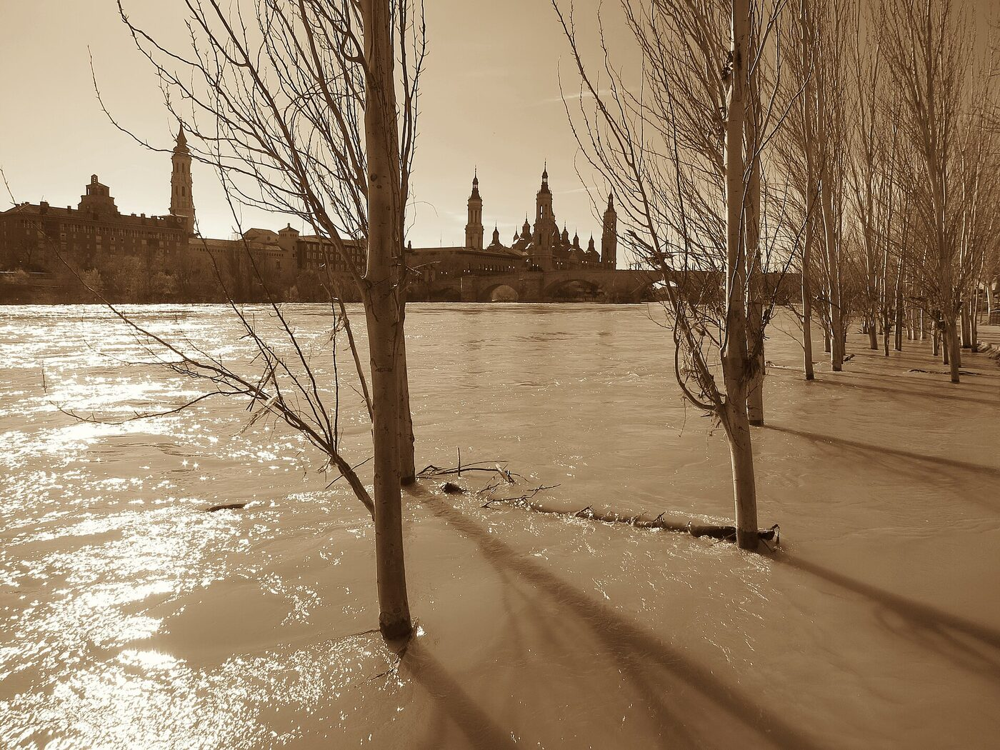

# La Tierra como sistema

Vivimos sobre una roca que gira alrededor de una estrella, rodeada de una capa finísima de aire y de agua. Todo eso funciona a la vez: lo que le pasa al aire afecta al agua, lo que le pasa al agua afecta al suelo, y lo que le pasa al suelo afecta a los seres vivos. Ese conjunto es lo que estudiamos en este tema.

::: resumen Lo esencial
Al terminar el tema deberías ser capaz de:

- Explicar qué son las cuatro esferas de la Tierra y poner ejemplos de cómo se relacionan.
- Justificar por qué el suelo es imprescindible para la vida y de qué está hecho.
- Describir un ecosistema con sus elementos bióticos y abióticos y sus relaciones.
- Distinguir tiempo atmosférico de clima y una causa de una consecuencia.
- Explicar qué son las placas tectónicas, qué procesos genera su movimiento y cómo se puede reducir el riesgo.
  :::

## Qué vamos a hacer en este tema

Este tema no empieza con una lista de definiciones. Empieza con una pregunta que no se responde con una sola búsqueda ni con una sola asignatura:

> **La pregunta guía:** ¿qué relación hay entre el aire, el agua, el suelo, los seres vivos, el clima y los riesgos de un lugar?

Para responderla vas a investigar y a resumir lo que aprendas en **una cartulina tuya**. No es un trabajo en grupo y no hay que exponer delante de la clase: cada uno hace su mural y lo entrega.

### El producto: tu cartulina

Tu cartulina tiene que tener cuatro bloques. Cada bloque se apoya en un apartado de estos apuntes:

| Bloque | Apartado | Qué tiene que aparecer |
|---|---|---|
| 1 | La Tierra como sistema | Las cuatro esferas, dos relaciones entre ellas y el suelo |
| 2 | Los ecosistemas | Un ecosistema concreto, bióticos, abióticos y dos relaciones |
| 3 | El clima y el cambio climático | Tiempo y clima, causa, consecuencias, acciones y un dato |
| 4 | La geología y los riesgos naturales | Placas, procesos internos y externos, riesgo y prevención |

Además, la cartulina tiene que tener al menos **dos flechas o frases que conecten un bloque con otro** y **dos fuentes** escritas.

### Cómo se trabaja: cuatro sesiones

| Sesión | Parte del cuadernillo | Apartado de estos apuntes |
|---|---|---|
| 1 | Parte 1 | La Tierra como sistema |
| 2 | Parte 2 | Los ecosistemas |
| 3 | Parte 3 | El clima y el cambio climático |
| 4 | Parte 4 y boceto | La geología y los riesgos naturales |

::: importante
En esas cuatro sesiones **no se empieza a decorar la cartulina**. Primero se rellena el cuadernillo y se hace el boceto. La cartulina se monta en clase, los días 3 y 4 de diciembre.
:::

### Qué es una buena cartulina y qué no lo es

Una buena cartulina **explica**. No es un collage bonito ni un resumen copiado.

- Sí vale: frases cortas escritas por ti, esquemas con título, un dato con una frase que diga qué muestra, flechas que relacionen ideas y dos fuentes anotadas.
- No vale: párrafos copiados de Internet, imágenes sin explicación ni origen, cuatro apartados sueltos sin relación, mucho color y poca información.

### Cómo se anota una fuente

Copia este modelo en una esquina de la cartulina o en el reverso:

::: nota
**1.** Organismo o autor. *Título de la página*. Dirección o nombre del sitio.
**2.** ¿Para qué la he usado?

Ejemplo: *AEMET. «El tiempo en Zuera». www.aemet.es. Lo he usado para comprobar la lluvia de un mes.*
:::

### Cómo se evalúa

Lo que más pesa es que el contenido sea correcto y esté completo, y que expliques las relaciones con tus palabras. Las fuentes anotadas y el orden también cuentan, pero el dibujo y la decoración no dan nota por sí solos. Después de la cartulina habrá una ficha de conexión y una prueba escrita breve: la nota de la unidad no depende solo del mural.


## La Tierra como sistema

### Las cuatro esferas

La Tierra no es una cosa sola, sino un **sistema** formado por partes que intercambian materia y energía. Para estudiarlas, las dividimos en cuatro **esferas** o capas, aunque en la realidad están en contacto permanente:

| Esfera | Qué incluye | Ejemplos |
|---|---|---|
| **Atmósfera** | La capa de gases que envuelve el planeta | El aire que respiras, las nubes, el viento |
| **Hidrosfera** | Toda el agua del planeta | Océanos, ríos, lagos, agua subterránea, hielo |
| **Geosfera** | La parte rocosa: corteza, manto y núcleo | Rocas, arena, magma, montañas |
| **Biosfera** | Todos los seres vivos y los lugares donde viven | Pinos, insectos, bacterias, personas |



::: nota
Estas cuatro «esferas» no están separadas como las capas de una cebolla. Se tocan y se mezclan de continuo. Una gota de lluvia pertenece a la hidrosfera, pero viaja por la atmósfera, cae sobre la geosfera y la usan los seres vivos de la biosfera.
:::

### Cómo se relacionan

Una de las ideas más importantes del tema es que **todo está conectado**. Algunos ejemplos:

- **Lluvia y suelo**: el agua de la atmósfera cae sobre la geosfera, disuelve minerales y permite que crezcan las plantas de la biosfera.
- **Volcán y clima**: un volcán (geosfera) lanza cenizas y gases a la atmósfera, que pueden enfriar el clima durante meses.
- **Plantas y roca**: las raíces de las plantas (biosfera) rompen la roca (geosfera) y forman suelo.
- **Océano y aire**: el agua de los mares (hidrosfera) se evapora y pasa a la atmósfera; después vuelve a caer.

::: ejemplo Pensar en cadena
Si un verano no llueve:

1. La hidrosfera recibe menos agua.
2. La atmósfera tiene menos humedad.
3. El suelo pierde agua y se endurece.
4. Las plantas crecen menos y algunos animales se marchan.
5. Las personas pueden tener problemas de agua y de alimento.

Eso es **pensar como un sistema**: no buscar una única causa, sino seguir la cadena.
:::

### El suelo, el gran desconocido

El **suelo** es la capa superficial, suelta, en la que pueden crecer las plantas. No es «tierra» sin más: es el resultado de una mezcla compleja y de un proceso muy lento.

<figure style="margin:14px 0;text-align:center">

<figcaption style="font-size:0.88em;font-style:italic;color:#555;margin-top:6px;line-height:1.45">Un suelo abierto por la mitad: arriba, los restos de hojas y las raíces; abajo, las capas de roca y arcilla. La cinta mide centímetros. Foto: CWALTER, CC BY-SA 4.0, Wikimedia Commons.</figcaption>
</figure>

Un suelo sano tiene cuatro componentes:

- **Materia mineral**: fragmentos de roca de distintos tamaños (arena, limo, arcilla).
- **Materia orgánica**: restos de plantas y animales en descomposición, y microorganismos. Cuando está muy descompuesta se llama **humus**.
- **Agua**: rellena los huecos entre las partículas.
- **Aire**: ocupa otros huecos; los seres vivos del suelo también respiran.

```
        suelo = minerales + materia orgánica + agua + aire
                 (roca)      (restos vivos)     (huecos)
```

La formación del suelo (**edafogénesis**) es un proceso que combina dos tipos de fenómenos:

1. **Meteorización** de la roca: el agua, el viento, el hielo y los cambios de temperatura rompen la roca poco a poco.
2. **Aporte de materia orgánica**: los seres vivos aportan hojas, excrementos y cuerpos que se descomponen.

Todo eso tarda muchísimo tiempo. Un centímetro de suelo puede necesitar siglos. Por eso decir «total, es solo tierra» es un error: el suelo es un recurso **no renovable** a escala humana.

::: dato ¿Para qué sirve el suelo?
- Es el soporte de casi todos los alimentos que comemos.
- Filtra y limpia el agua que se infiltra hacia los acuíferos.
- Almacena enormes cantidades de carbono: si se degrada, se libera gases de efecto invernadero.
- Alberga una parte enorme de la biodiversidad del planeta: en un puñado de suelo sano hay millones de microorganismos.
:::

::: actividades

1. Nombra las cuatro esferas de la Tierra y pon un ejemplo de cada una que veas en tu entorno.
2. Escribe dos relaciones entre esferas: una que implique al suelo y otra que no.
3. Explica con tus palabras por qué el suelo se considera un recurso no renovable.
4. ¿Qué componentes del suelo hacen posible que crezca una planta?
   :::

## Los ecosistemas

### Qué es un ecosistema

Un **ecosistema** es el conjunto formado por un lugar y todos los seres vivos que lo habitan, junto con las relaciones que se establecen entre ellos. Distinguimos dos partes:

- El **biotopo**: el medio físico. Incluye el **agua, el aire, el suelo, la luz, la temperatura** y la cantidad de precipitaciones.
- La **biocenosis** o **comunidad**: todos los seres vivos que viven en ese biotopo.

Cuando hablamos de los elementos del medio físico usamos la palabra **abiótico** (sin vida) y, cuando hablamos de los seres vivos, **biótico**.

| Elementos abióticos | Elementos bióticos |
|---|---|
| Luz, temperatura, agua, suelo, oxígeno, salinidad | Plantas, animales, hongos, bacterias |

<figure style="margin:14px 0;text-align:center">

<figcaption style="font-size:0.88em;font-style:italic;color:#555;margin-top:6px;line-height:1.45">Un soto del Ebro: agua, juncos, árboles y animales en el mismo lugar. Todo eso, junto con el suelo y la luz, forma un ecosistema. Foto: Kalakoricos, CC BY-SA 4.0, Wikimedia Commons.</figcaption>
</figure>

::: nota
Una **población** son los individuos de la misma especie que viven en un ecosistema (por ejemplo, todas las truchas del río). La **comunidad** o biocenosis es el conjunto de todas las poblaciones que viven allí.
:::

### Las relaciones entre organismos

Los seres vivos no viven aislados. Se relacionan con los de su especie (**relaciones intraespecíficas**) y con los de otras especies (**relaciones interespecíficas**).

| Relación | Qué pasa | Ejemplo |
|---|---|---|
| **Cooperación** | Los dos se benefician | Bandadas de aves que vigilan juntas |
| **Competencia** | Los dos compiten por lo mismo y se perjudican | Dos especies que comen el mismo fruto |
| **Depredación** | Uno caza al otro | Zorro y conejo |
| **Parasitismo** | Uno se beneficia y perjudica al otro | Garrapata sobre un perro |
| **Mutualismo** | Ambos obtienen beneficio y no pueden vivir bien por separado | Líquenes (alga + hongo) |

### Cómo circula la materia y la energía

En los ecosistemas, la materia y la energía pasan de unos seres vivos a otros. Según el papel que desempeñan, encontramos:

- **Productores**: fabrican su propio alimento con la **fotosíntesis**. Son las plantas, las algas y algunas bacterias.
- **Consumidores**: se alimentan de otros seres vivos.
  - **Primarios**: comen productores (herbívoros).
  - **Secundarios**: comen consumidores primarios.
  - **Terciarios**: comen consumidores secundarios.
- **Descomponedores**: descomponen los restos y los cuerpos sin vida y devuelven los nutrientes al suelo. Son hongos y bacterias.

Una **cadena alimentaria** muestra una secuencia de quién come a quién:

$$ \text{hierba} \longrightarrow \text{conejo} \longrightarrow \text{zorro} \longrightarrow \text{buitre} $$

En la realidad, los seres vivos se comen de muchas maneras: no hay una sola cadena, hay una **red trófica**, un entramado de cadenas cruzadas.



::: dato Se pierde energía
En cada salto de la cadena se pierde una enorme cantidad de energía, sobre todo en forma de calor. Por eso hacen falta muchas plantas para mantener pocos depredadores, y por eso las cadenas tróficas tienen pocos niveles.
:::

### Cuando el ecosistema cambia

Los ecosistemas cambian. Un cambio puede ser natural (una sequía, un incendio provocado por un rayo) o debido a la actividad humana (contaminación, deforestación, especies invasoras).

Un ecosistema es **frágil pero también resistente**: puede recuperarse hasta cierto punto. Si el cambio es muy fuerte o muy rápido, esa capacidad de recuperación se pierde.

::: ejemplo La sequía, paso a paso
Si en un río llueve mucho menos:

1. Baja el nivel del agua y se calienta más.
2. Disminuye el oxígeno disuelto y los peces sufren.
3. Las algas crecen más de la cuenta y el agua se enturbia.
4. Los animales que dependen del río buscan otros lugares.

Un solo cambio en un elemento abiótico afecta a todo el ecosistema.
:::

::: actividades

1. Elige un ecosistema cercano. Señala tres elementos bióticos y tres abióticos.
2. Construye una cadena alimentaria de cuatro niveles y explica qué papel tiene cada uno.
3. ¿Qué diferencia hay entre cooperación y mutualismo? Pon un ejemplo de cada uno.
4. Explica qué pasaría en tu ecosistema si desaparecieran los descomponedores.
   :::

## El clima y el cambio climático

### Tiempo y clima no son lo mismo

Es un error muy común usar estas dos palabras como si fueran iguales. Vamos a diferenciarlas:

- El **tiempo atmosférico** es el estado de la atmósfera en un lugar y un momento concretos: hoy, esta semana. Incluye la temperatura, las precipitaciones, el viento y la humedad de ahora.
- El **clima** es el conjunto de condiciones atmosféricas **habituales** en un lugar, calculado con datos recogidos durante al menos 30 años.

Dicho de otra forma: **el tiempo es lo que te pones hoy para salir a la calle; el clima es la ropa que guardas para todo el año**.

::: nota
«Hoy hace frío en Zuera» habla del tiempo. «Zuera tiene clima mediterráneo continentalizado» habla del clima.
:::

El clima de un lugar depende de varios **factores**:

- La **latitud**: no es lo mismo el ecuador que el norte de Europa.
- La **altitud**: hace más frío en las montañas.
- La **distancia al mar**: el mar suaviza las temperaturas.
- El **relieve**: las montañas frenan las nubes y crean sombras de lluvia.
- Las **corrientes marinas**, que calientan o enfrían las costas.

### El cambio climático: causas y consecuencias

El **efecto invernadero** natural no es malo: sin él, la Tierra sería un lugar congelado. El problema aparece cuando lo intensificamos. Al quemar combustibles fósiles y talar bosques, emitimos gases que **retienen más calor** del necesario.



**Causas principales:**

- Quema de **combustibles fósiles** (carbón, petróleo, gas) para electricidad, transporte e industria.
- **Deforestación**: menos árboles que capturen $\text{CO}_2$.
- **Ganadería intensiva** y agricultura con fertilizantes.
- Residuos y consumo: la fabricación de dispositivos también emite gases.

**Consecuencias:**

- Aumento de la temperatura media del planeta.
- Cambios en las lluvias: sequías más largas en algunos lugares y lluvias torrenciales en otros.
- Subida del nivel del mar por el deshielo y la dilatación del agua.
- Olas de calor más frecuentes e intensas.
- Pérdida de biodiversidad y cambios en los ecosistemas.
- Problemas sociales: gente que tiene que abandonar su casa, conflictos por el agua.

::: importante
No confundas **causa** con **consecuencia**. Que suba el nivel del mar no provoca las emisiones; al revés: las emisiones (causa) provocan la subida del nivel del mar (consecuencia).
:::

### Cómo frenarlo: mitigar y adaptarse

Hay dos formas de responder al cambio climático, y no son la misma:

- **Mitigación**: reducir las causas. Disminuir emisiones, usar energías renovables, ahorrar energía, consumir menos y mejor.
- **Adaptación**: prepararse para los efectos que ya no podemos evitar. Construir mejor, ordenar el territorio, avisar de inundaciones.

::: dato Lo que más pesa en un dispositivo
La mayor parte de la huella de un teléfono o un ordenador no está en el día que lo usas, sino en **fabricarlo**: extraer minerales, fabricar piezas y transportarlas. Por eso alargar la vida útil de un dispositivo, repararlo o comprarlo de segunda mano suele ahorrar más emisiones que apagarlo cinco minutos antes.
:::

Hay que desconfiar de las soluciones que suenan bien pero no cuantifican. Una empresa que anuncia un producto «100 % ecológico» no está obligada a decirte cuánto contamina fabricarlo. Por eso se pide siempre el dato.

### Leer un dato sin equivocarse

En este tema vamos a usar datos climáticos. La matemática sirve para no creernos cualquier cosa:

- Un **porcentaje** siempre tiene un «de qué»: 10 % de qué cantidad.
- Un **aumento** del 20 % no es lo mismo que un aumento de 20 unidades.
- Una variación puede parecer enorme si se dibuja el eje del gráfico empezando muy arriba.
- Un dato de **un día** no demuestra una tendencia. La tendencia necesita muchos años.



::: ejemplo Un gráfico engañoso
Imagina un gráfico donde se mide la temperatura media de una ciudad. El eje vertical no empieza en $0$, sino en $13{,}8\,^\circ\mathrm{C}$. Con ese truco, un aumento de $0{,}4\,^\circ\mathrm{C}$ parece enorme. El dato es real; la forma de dibujarlo es lo que engaña.
:::

::: actividades

1. Define tiempo atmosférico y clima con tus palabras y pon un ejemplo de cada uno de tu localidad.
2. Escribe una causa y dos consecuencias del cambio climático. No las mezcles.
3. Escribe dos acciones justificadas: una que puedas hacer tú esta semana y otra colectiva o profesional.
4. Busca un dato sobre residuos electrónicos o consumo de energía de un ordenador. Copia el dato y explica qué muestra y qué **no** permite concluir.
   :::

## La geología y los riesgos naturales

### El interior de la Tierra

La geosfera se divide en tres capas principales:

- **Corteza**: la capa más externa, sólida y delgada. En los continentes mide entre 30 y 70 km; bajo los océanos, unos 7 km.
- **Manto**: es la capa intermedia, muy gruesa. Aunque sus rocas están calientes, no forman un líquido: se deforman muy despacio.
- **Núcleo**: la parte más interna, con una parte externa líquida y una interna sólida. Tiene temperaturas altísimas.

La **litosfera** es la capa rígida exterior formada por la corteza más la parte más alta del manto. Está **fragmentada en placas** que flotan sobre el material más blando del manto y se mueven muy lentamente, unos centímetros al año.



### Qué pasa cuando las placas se mueven

La **tectónica de placas** explica el relieve, los terremotos y los volcanes. Según cómo se muevan las placas entre sí, ocurre algo distinto:

| Tipo de límite | Qué hacen las placas | Qué produce |
|---|---|---|
| **Divergente** | Se separan | Dorsales oceánicas, volcanes, nueva corteza |
| **Convergente** | Chocan: una se hunde bajo la otra | Montañas, terremotos fuertes, volcanes |
| **Transformante** | Se desplazan una al lado de la otra | Terremotos, fallas, sin volcanes |

::: dato España, sin ir más lejos
- Los Pirineos se formaron por la colisión entre la placa ibérica y la europea.
- En el Pirineo todavía hay pequeños terremotos por fallas activas.
- En la península hay volcanes recientes (La Garrotxa, Campo de Calatrava) además de los de Canarias.
- El valle del Ebro ha sufrido inundaciones históricas por el río y sus afluentes.
:::

### Procesos internos y procesos externos

El relieve cambia por dos tipos de fuerzas opuestas:

- **Procesos internos**: vienen de la energía del interior de la Tierra. **Forman** relieve. Son los volcanes, los terremotos y la formación de montañas.
- **Procesos externos**: vienen de la energía del Sol y de la gravedad. **Destruyen** y modelan el relieve. Son la meteorización, la erosión, el transporte y la sedimentación.

| Proceso | Ejemplo | Tipo |
|---|---|---|
| Erupción volcánica | Colada de lava en La Palma | Interno |
| Formación de una cordillera | Pirineos | Interno |
| Erosión de un barranco por un río | Barrancos de la zona | Externo |
| Acumulación de arena en una playa | Sedimentación en el delta del Ebro | Externo |

### Riesgos naturales y prevención

Un **riesgo natural** es la posibilidad de que un fenómeno natural cause daños. Es importante entender que el peligro es natural, pero **el daño depende también de las personas**:

$$
\text{riesgo} = \text{peligrosidad} \times \text{exposición} \times \text{vulnerabilidad}
$$

- **Peligrosidad**: la probabilidad de que ocurra el fenómeno.
- **Exposición**: qué hay y quién está en la zona (casas, personas, cultivos).
- **Vulnerabilidad**: lo frágil que es lo expuesto.

<figure style="margin:14px 0;text-align:center">

<figcaption style="font-size:0.88em;font-style:italic;color:#555;margin-top:6px;line-height:1.45">Crecida del Ebro a su paso por Zaragoza, el 28 de marzo de 2015. El agua ocupa la ribera, donde normalmente hay un paseo. Foto: Olybrius, CC BY-SA 4.0, Wikimedia Commons.</figcaption>
</figure>

Por eso un terremoto en un desierto casi no causa daños y uno en una ciudad con edificios mal construidos es catastrófico.

**Medidas de prevención:**

- **Ordenación del territorio**: no construir en zonas inundables o en laderas inestables.
- **Construcción sismorresistente**: edificios que aguantan el movimiento y evitan derrumbes.
- **Sistemas de alerta temprana**: avisar de una inundación, una riada o una erupción con tiempo.
- **Planes de evacuación y educación**: saber qué hacer y por dónde salir.
- **Recuperación natural**: mantener vegetación en las laderas, recuperar riberas.

::: nota Predicción no es prevención
Predecir es decir cuándo pasará (casi imposible en terremotos). Prevenir es reducir el daño aunque el fenómeno no se pueda evitar. La prevención es lo que está en nuestra mano.
:::

::: actividades

1. Explica con un esquema qué son las placas tectónicas y qué tres tipos de límites existen.
2. Pon un ejemplo de proceso interno y otro de externo. Indica qué efecto tienen sobre el relieve.
3. Elige un riesgo natural de tu entorno. Identifica la peligrosidad, la exposición y la vulnerabilidad.
4. Propón dos medidas de prevención para ese riesgo y justifica cada una: ¿por qué reduce el daño?
   :::

## Actividades de repaso

### Bloque 1: la Tierra como sistema

1. Completa: la capa de gases es la ______, el agua forma la ______, la roca forma la ______ y los seres vivos, la ______.
2. Explica tres relaciones entre esferas, una de ellas protagonizada por el suelo.
3. Nombra los cuatro componentes del suelo y di para qué sirve la materia orgánica.
4. ¿Por qué el suelo tarda tanto en formarse? ¿Qué consecuencia tiene eso?

### Bloque 2: los ecosistemas

1. Define ecosistema, biotopo y biocenosis. Pon un ejemplo concreto.
2. Ordena de productor a descomponedor: búho, hierba, saltamontes, bacteria, ratón.
3. Indica qué tipo de relación es: dos leones que luchan por el mismo territorio; un pájaro que se alimenta de insectos; un hongo que crece sobre un tronco muerto; una garrapata en un perro.
4. Explica qué le ocurriría a una cadena trófica si desaparecieran los productores.

### Bloque 3: clima y datos

1. Ordena estos enunciados en «tiempo» o «clima»: «mañana llueve», «el verano es seco», «hoy hace 30 grados», «en los últimos 30 años la temperatura media ha subido un grado».
2. Escribe dos causas de cambio climático y dos consecuencias. Indica cuál es cada una.
3. En una ciudad, la temperatura ha pasado de $14{,}2\,^\circ\mathrm{C}$ a $14{,}6\,^\circ\mathrm{C}$ de media. Calcula el porcentaje de aumento respecto al valor inicial. Después explica por qué un gráfico con el eje desde $14$ exagera el cambio.
4. ¿Qué diferencia hay entre mitigación y adaptación? Pon un ejemplo de cada una.

### Bloque 4: geología y riesgos

1. Ordena las capas de la Tierra de fuera hacia dentro y di cuál es sólida, cuál es líquida y cuál se deforma despacio.
2. Explica qué ocurre cuando dos placas convergen y qué relieve producen.
3. Clasifica como interno o externo: erupción, erosión de un río, formación de una montaña, sedimentación en un delta.
4. Un pueblo se construye en el cauce antiguo de un río. ¿Aumenta la peligrosidad, la exposición o la vulnerabilidad? ¿Qué medida de prevención propondrías?

::: resumen Antes de entregar
Comprueba que puedes explicar, sin mirar los apuntes:

- Qué son las cuatro esferas y cómo se relacionan con el suelo.
- Qué elementos forman un ecosistema y cómo se relacionan los organismos.
- La diferencia entre tiempo y clima, y entre causa y consecuencia.
- Qué son las placas tectónicas y cómo se previene el daño de un riesgo natural.
  :::
